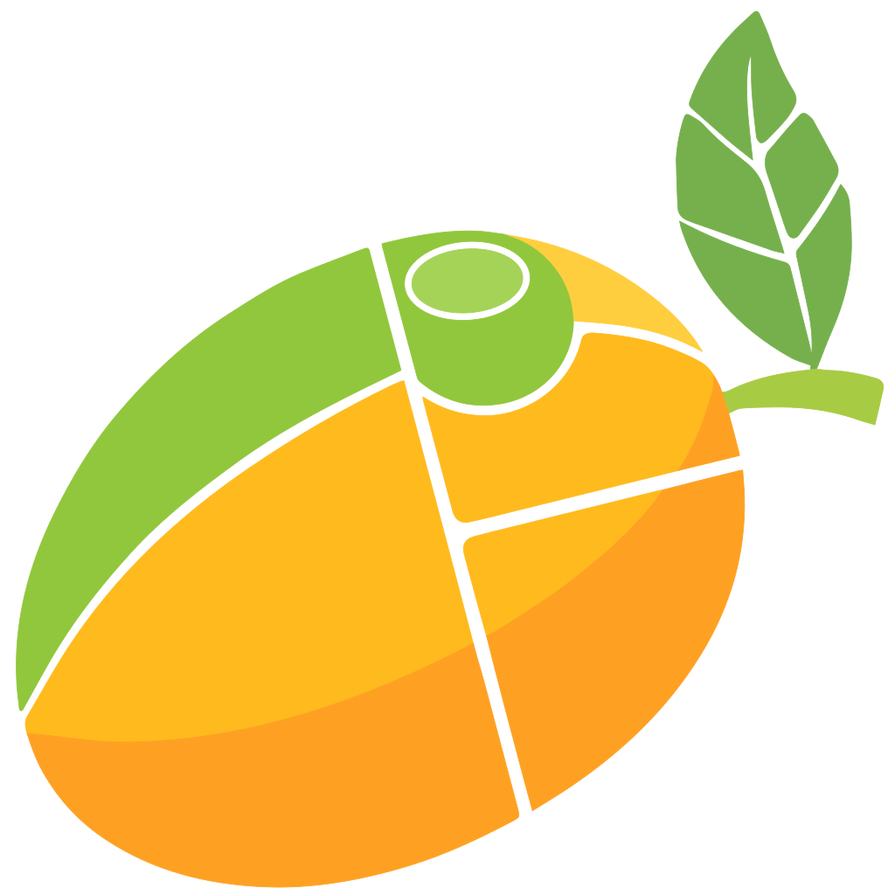

<div align="center">
  

  <h1>Mango Chutney</h1>

  <p>A tiling window manager for macOS, ported from <a href="https://github.com/mangowm/mango">mango</a></p>


</div>

---

Mango Chutney arranges your windows in a layout and lets you work with them from the keyboard.
Open a window and it takes its place next to the others; close it and the rest fill the space.

It is a port of [mango](https://github.com/mangowm/mango), a tiling window manager for Linux. The
layouts, tags and config are mango's. On top of that it adds a few things for the Mac: a Hyper
key, a menu bar item, a searchable list of keys, and colours that follow your system settings.

- 14 layouts: tile, scroller, monocle, deck, dwindle, grid and more ([see them](https://mangowm.github.io/))
- 9 tags per screen instead of desktops, each with its own layout (no macOS Spaces needed)
- floating windows, fullscreen, scratchpads, an overview and a window switcher
- a menu bar panel for layouts, gaps and borders

## Install

```bash
brew install --cask kim-raaschou/tap/mangochutney
open -a "Mango Chutney"
```

Needs macOS 14 or later on Apple silicon. Quit any other tiling window manager first.

The first start asks for Accessibility (Screen Recording is optional: pictures in the overview and
switcher) and for your **Hyper key**: Caps Lock, a left or right modifier, or a function key, as
Raycast's Hyper Key. Held, it acts as ⌃⌥⌘, which no app uses, so macOS's own shortcuts stay as
they are.

## Remember two keys

| Keys | Does |
|---|---|
| **Hyper K** | every key, searched by what you want to do: "float", "tag", "layout" |
| **Hyper L** | the layouts, as pictures |

Everything else is found from these two. A few more to start with:

| Keys | Does |
|---|---|
| Hyper ← ↑ → ↓ | focus left, up, right, down (with ⇧: move the window) |
| Hyper 1–9 | go to tag 1–9 (with ⇧: send the window there) |
| Hyper N | next layout |
| Hyper \ | float the window |
| Hyper F | fullscreen |
| Hyper Q | close the window |
| Hyper drag | move a window (right-drag resizes) |

## Config

The config is `~/.config/mango/config.conf`, mango's own format, and it reloads when you save it.
Near its end are a few lines to try. The menu bar's choices are kept in a file of their own and
never touch your config.

The **[guide](docs/guide.md)** has the rest: a first week with tiling, all the keys, the Hyper key,
the menu bar and palettes, one key per app, coming from AeroSpace or yabai, and Mango Chutney's own
`chutney_` options. Everything of mango's is in [mango's documentation](https://mangowm.github.io/docs).

## Coming from mango

Your mango config loads as it is, and `mmsg` works the same. Not everything is possible on macOS:

<!-- mango-glance:start -->
|  | In mango | Works on macOS | Not implemented yet | Cannot work on macOS |
| --- | --- | --- | --- | --- |
| Options | 239 | 151 | 0 | 88 |
| Keywords | 18 | 14 | 0 | 4 |
| Window-rule fields | 49 | 27 | 0 | 22 |
| Dispatchers | 94 | 82 | 0 | 12 |
| Layouts | 14 | 14 | 0 | 0 |
<!-- mango-glance:end -->

Blur, shadows, other apps' opacity, input devices, display modes and the layer shell are out of
reach, and windows on hidden tags are moved to a corner of the screen.
[Compatibility](docs/compatibility.md) has the full list, and `mango -p` checks your config. The
Mac additions are all named `chutney_` and are off unless set; delete them and it behaves as mango,
with the keys still on Hyper (⌃⌥⌘ held).

## Status

Beta (0.0.1-20261103-beta). I use it every day, but there are rough edges. Bugs go in this repo's
issues; questions about mango itself go to [mango](https://github.com/mangowm/mango) or its
[Discord](https://discord.gg/CPjbDxesh5).

## Development

```bash
make test         # the tests (XCTest needs Xcode)
make install      # build into /Applications, link mango and mmsg into ~/.local/bin
make check        # validate Resources/config.conf
make release      # the signed zip, dist/MangoChutney-<version>.zip
```

- **`Sources/Mango`** is mango's code in Swift, function by function, with mango's names and no
  macOS framework.
- **`Sources/Boundary`** is where wlroots stands for mango: `WindowSystem`, `PortHooks`, the event
  loop.
- **`Sources/Port`** is macOS: `macOS` (Accessibility, the event tap, borders and bars, hiding
  windows, focus) and `Extensions` (Mango Chutney's own, joined to mango only through `PortHooks`).
- **`Sources/MangoApp`** is the app and its menu bar; **`Sources/mmsg`** the command line client.

Every deviation from mango is listed in [afvigelser.md](docs/afvigelser.md) (in Danish).

## Acknowledgements

- [mango](https://github.com/mangowm/mango) by DreamMaoMao and contributors, which this is a port
  of. The logo (`Resources/mango.svg`) is mango's (`assets/mango.svg`, see
  [mangowm.github.io/brand](https://mangowm.github.io/brand)), under mango's GPL-3.0 license.
- [dwl](https://codeberg.org/dwl/dwl), which mango is built on.
- [AeroSpace](https://github.com/nikitabobko/AeroSpace) and [rift](https://github.com/acsandmann/rift)
  for showing how to do this on macOS. The rules for which windows are tiled and which float are
  AeroSpace's (MIT, `docs/licenses/AeroSpace-LICENSE.txt`).
- [mangobutter](https://justaguy.dev/drew/mangobutter), whose quickshell panel the layout panel is
  based on.
- [Omarchy](https://omarchy.org/) for the hotkeys palette, [Raycast](https://www.raycast.com/) for
  the Hyper Key, and AeroControl for `chutney_focus_app`.
